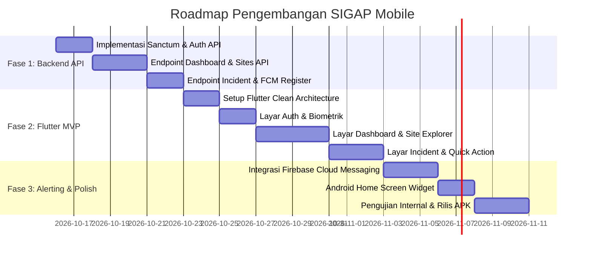

# Product Requirements Document (PRD)
# SIGAP Mobile — Android Application

---

## 📌 1. Informasi Dokumen
- **Nama Produk**: SIGAP Mobile (Sistem Informasi Gangguan & Analisis Performa)
- **Versi Dokumen**: 1.0.0
- **Target Platform**: Android (Flutter SDK)
- **Backend API**: Laravel 11/12 Octane (FrankenPHP) — `https://sigap.humacode.my.id/api/v1`
- **Tanggal Dibuat**: 15 Oktober 2026
- **Status**: Draft Disetujui (Ready for Implementation)

---

## 🎯 2. Latar Belakang & Pernyataan Masalah (Problem Statement)

### Latar Belakang
SIGAP Web telah berhasil dideploy di server produksi sebagai platform pemantauan menyeluruh untuk puluhan website, API, aplikasi web, dan infrastruktur digital enterprise/organisasi. Sistem ini secara otomatis memonitor uptime per menit, mendeteksi insiden defacement visual/malicious code, memindai port sensitif, dan mengaudit kedaluwarsa sertifikat SSL.

### Masalah yang Dihadapi (Problem Statement)
1. **Keterbatasan Web Dashboard**: Tim IT, DevOps, SRE, dan pengambil keputusan tidak selalu berada di depan laptop atau membuka tab browser 24 jam sehari.
2. **Keterlambatan Respon Darurat**: Ketika website/layanan produksi down atau mengalami gangguan keamanan di luar jam kerja, notifikasi berbasis web sering kali terlambat disadari, berakibat pada pelanggaran SLA dan kerugian operasional.
3. **Ketiadaan Aksi Instan (One-Tap Action)**: Belum ada sarana cepat untuk menandai bahwa suatu insiden kritis sedang ditangani (*acknowledged*) secara *on-the-go* langsung dari smartphone.

### Solusi Produk (Product Solution)
Membangun aplikasi mobile Android **SIGAP Mobile** berbasis **Flutter** yang terhubung langsung ke API Laravel Octane. Fokus utama aplikasi adalah **kecepatan tanggap darurat (*Rapid Incident Response*)** melalui Push Notification berprioritas tinggi, ringkasan eksekutif kesehatan layanan digital, dan penanganan insiden satu sentuhan.

---

## 👥 3. Target Pengguna & Persona

| Persona | Peran Utama | Kebutuhan Utama di Mobile |
| :--- | :--- | :--- |
| **DevOps / SRE / Sysadmin** | Tim On-Call 24/7 | Notifikasi instan saat website/API down, cek latensi/ping langsung dari HP, update status insiden. |
| **Security Engineer / InfoSec** | Tim Keamanan Siber | Notifikasi defacement, sertifikat SSL kedaluwarsa, pemindaian port terbuka, dan mitigasi awal. |
| **Product Owner / IT Executive** | Pengambil Kebijakan | Melihat ringkasan SLA Uptime bulanan, skor kesehatan seluruh layanan digital tanpa detail teknis berlebih. |

---

## 🚀 4. Tujuan Produk (Product Goals & KPIs)

1. **MTTA (Mean Time to Acknowledge)**: Menurunkan waktu konfirmasi insiden dari rata-rata 45 menit menjadi **di bawah 5 menit**.
2. **Keandalan Notifikasi**: 99.9% notifikasi insiden kritis (*Critical*) terkirim ke smartphone tim dalam waktu < 3 detik setelah terdeteksi.
3. **Performa Aplikasi Mobile**: Waktu buka aplikasi (*Cold Start*) < 1.5 detik, response API < 100ms berkat arsitektur FrankenPHP Octane.

---

## 📱 5. Spesifikasi Fitur Fungsional (Feature Modules)

### Modul 1: Autentikasi & Keamanan Pengguna
- **Login Akun**: Menggunakan username/email dan password yang sama dengan akun SIGAP Web.
- **Autentikasi Token**: Laravel Sanctum (`Bearer Token`) dengan refresh token aman.
- **Autentikasi Biometrik**: Dukungan Fingerprint / Face Unlock untuk login instan setelah login pertama.
- **Role-Based UI**:
  - *Admin/Dev*: Akses penuh (Ubah status insiden, trigger ping manual, kelola penugasan teknisi).
  - *User/Executive*: Mode pantau (*View-Only*) dengan tampilan kartu metrik eksekutif.

### Modul 2: Executive Dashboard (Layar Utama)
- **Ringkasan Skor & Kesehatan**:
  - Persentase Uptime Gabungan (misal: `99.85%`).
  - Kartu Metrik: Total Layanan, Layanan Normal (Hijau), Layanan Gangguan (Merah), Layanan Warning (Kuning).
- **Banner Peringatan Kritis**: Muncul di bagian teratas jika ada insiden aktif berstatus *Critical*.
- **Grafik Sparkline Latensi**: Tren waktu respons rata-rata 24 jam terakhir.
- **Feed Insiden Terkini**: 3 insiden terbaru yang membutuhkan perhatian cepat.

### Modul 3: Manajemen & Pemantauan Situs (Site Explorer)
- **Daftar Layanan Digital Komprehensif**:
  - Pencarian instan berdasarkan nama layanan atau URL domain.
  - Filter cepat: *Semua, Normal, Gangguan, Peringatan SSL*.
  - Indikator per kartu: Status Badge, Latensi (ms), Sisa Hari SSL (badge merah jika < 7 hari), Tanggal Audit Terakhir.
  - *Pull-to-Refresh* untuk memperbarui data realtime.
- **Halaman Detail Situs**:
  - Riwayat Uptime (kalender 30 hari mini).
  - Status Audit SSL (Penerbit, Masa Berlaku, Algoritma).
  - Status Deteksi Visual & Defacement.
  - Tombol **"Trigger Manual Health Check"** (memerintahkan server memeriksa situs tersebut saat itu juga).

### Modul 4: Pusat Penanganan Insiden (Incident Center)
- **Daftar Insiden Aktif & Riwayat**:
  - Filter berdasarkan tingkat keparahan (*Critical, High, Medium, Low*).
  - Filter berdasarkan status: *Investigating, In Progress, Resolved*.
- **Detail Investigasi Insiden**:
  - Waktu mulai terjadi (durasi *downtime* berjalan).
  - Log analisis otomatis (kode HTTP, error message, screenshot jika defacement).
  - Analisis Cepat AI dari 9Router (rekomendasi mitigasi dan solusi pemulihan).
- **Aksi Cepat Mobile**:
  - Mengubah status insiden: *Acknowledge* ➔ *In Progress* ➔ *Resolved*.
  - Menambahkan catatan investigasi teknisi (*Technician Note*).
  - Tombol **"Bagikan Laporan ke WhatsApp / Tim"**: Memformat ringkasan insiden menjadi pesan teks rapi untuk diteruskan ke grup koordinasi tim.

### Modul 5: Sistem Notifikasi Push (Push Notifications)
- **Integrasi Firebase Cloud Messaging (FCM)**:
  - Notifikasi background & foreground dengan channel prioritas tinggi di Android.
  - Nada dering khusus untuk insiden darurat (*Alarm Sound*).
- **Pengaturan Notifikasi Mandiri di Aplikasi**:
  - Opsi: *Hanya beritahu insiden Critical*, *Semua Gangguan*, atau *Ringkasan Harian*.
  - Mode *Do Not Disturb* (Jam Tenang) kecuali untuk insiden kategori *Critical*.

### Modul 6: Android Home Screen Widget (Fase Lanjutan)
- Widget ukuran 2x2 atau 4x2 di layar depan HP Android:
  - Menampilkan jumlah layanan Normal vs Down.
  - Indikator warna lingkaran (Hijau jika semua aman, Berkedip Merah jika ada gangguan).
  - Diperbarui otomatis di background setiap 15-30 menit.

---

## 🛠️ 6. Arsitektur Teknis & Tech Stack

### Frontend Mobile (Flutter)
- **SDK**: Flutter 3.24+ / Dart 3.5+
- **Pola Arsitektur**: **Clean Architecture (Feature-First)**:
  - `lib/features/[feature_name]/presentation/` (Widgets, Screens, BLoC/Cubit)
  - `lib/features/[feature_name]/domain/` (Entities, Use Cases)
  - `lib/features/[feature_name]/data/` (Models, Data Sources, Repositories)
- **State Management**: `flutter_bloc` / `cubit`
- **Networking**: `dio` (Interceptor untuk Bearer Token, logging, retry on timeout)
- **Local Storage**:
  - `flutter_secure_storage`: Menyimpan access token, refresh token, & biometrik.
  - `hive_flutter`: Cache data situs & dashboard agar bisa dibuka saat offline/minim sinyal.
- **Push Notification**: `firebase_messaging` + `flutter_local_notifications`
- **UI & Iconography**: `lucide_icons` / `heroicons`, Google Fonts (`Plus Jakarta Sans`), `fl_chart` untuk grafik performa.

### Backend API (Laravel SIGAP)
- **Base URL**: `https://sigap.humacode.my.id/api/v1`
- **Autentikasi**: Laravel Sanctum (`auth:sanctum`)
- **Protokol**: RESTful JSON API
- **Spesifikasi Header**:
  ```http
  Accept: application/json
  Authorization: Bearer <token_sanctum>
  ```

---

## 📡 7. Spesifikasi Kontrak API (API Endpoints)

| Method | Endpoint | Deskripsi | Hak Akses |
| :---: | :--- | :--- | :---: |
| `POST` | `/api/v1/auth/login` | Login user, mengembalikan token Sanctum & role | Publik |
| `POST` | `/api/v1/auth/logout` | Revoke token aktif saat logout | Sanctum |
| `GET` | `/api/v1/auth/me` | Ambil profil pengguna & daftar hak akses | Sanctum |
| `GET` | `/api/v1/dashboard/stats` | Statistik kartu utama, persentase uptime, insiden aktif | Sanctum |
| `GET` | `/api/v1/sites` | Daftar seluruh website (support search & pagination) | Sanctum |
| `GET` | `/api/v1/sites/{id}` | Detail lengkap metrik 1 website & riwayat uptime | Sanctum |
| `POST` | `/api/v1/sites/{id}/check` | Trigger pengecekan manual kesehatan website | Admin/Dev |
| `GET` | `/api/v1/incidents` | Daftar insiden (support filter status & severity) | Sanctum |
| `GET` | `/api/v1/incidents/{id}` | Detail insiden, root cause, & rekomendasi AI | Sanctum |
| `PATCH`| `/api/v1/incidents/{id}/status`| Update status insiden (*In Progress / Resolved*) | Admin/Dev |
| `POST` | `/api/v1/devices/token` | Daftarkan FCM token perangkat untuk push notifikasi | Sanctum |

---

## 🎨 8. Desain & Panduan UI/UX

- **Tema Tampilan**: Dark Mode Sleek (*Default*) dengan opsi Light Mode.
  - Background Utama: `Slate 950` (`#020617`) & Card Background: `Slate 900` (`#0f172a`).
  - Aksen Warna Status:
    - Normal / Up: `Emerald 400` (`#34d399`) dengan efek glowing.
    - Gangguan / Down: `Rose 500` (`#f43f5e`).
    - Warning / Peringatan: `Amber 400` (`#fbbf24`).
    - Primary Brand: `Indigo 500` (`#6366f1`).
- **Tipografi**: *Plus Jakarta Sans* (Heading Semi-Bold, Body Regular).
- **Haptic Feedback**: Getaran halus pada smartphone saat pengguna menyegarkan data (*Pull-to-refresh*) atau berhasil memperbarui status insiden.

---

## 📅 9. Rencana Rilis & Milestone Pengembangan



---

## 🛡️ 10. Manajemen Risiko & Keamanan Data

1. **Keamanan Token di Smartphone**: Token login disimpan di Android Keystore via `flutter_secure_storage`. Jika smartphone terdeteksi di-root, pengguna diberikan peringatan keamanan.
2. **Offline Resilience**: Jika server atau jaringan internet ponsel mati mendadak, aplikasi tetap dapat dibuka dan menampilkan data terakhir yang dicache di penyimpanan lokal `Hive` dengan badge *"Menampilkan data offline"*.
3. **Pemberitahuan Otomatis Kadaluarsa Token**: Jika sesi habis, aplikasi otomatis mengarahkan ke layar login dengan biometrik tanpa membuang preferensi pengguna.
